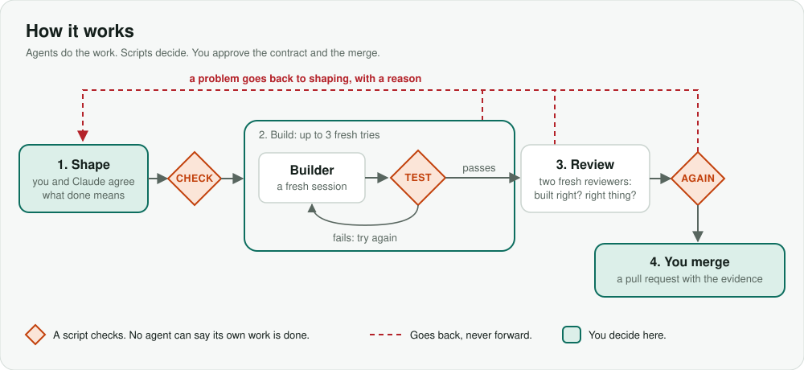

# AI Loop Kit

Build software with Claude Code in small steps. A script checks each step before you review the change.

Version 1.0.0 is released. It works best with Python and Node projects.



## What it does

1. Shape an idea into a **piece**: a GitHub issue with the task, its limits and a contract. The contract lists the results the change must meet.
2. You approve the task and its contract before work starts.
3. Run the piece. Claude gets up to three fresh tries to build it.
4. The **gate**, a script that controls the steps, runs a **judge** (tests for the contract) and your **keep check** (the project's full test command). Two fresh reviewers check the code and the contract. The gate runs the checks again.
5. If the checks pass, the gate opens a pull request. You read it and merge it.

## Who it is for

One developer using Claude Code with a GitHub project, who wants to review small pull requests.

## Install

In Claude Code, run:

```text
/plugin marketplace add gwpicard/ai-loop-kit
/plugin install ai-loop-kit@ai-loop-kit
/ai-loop-kit:setup
```

### What you need

- `git` and `gh` signed in to GitHub
- Python 3.9 or later
- A GitHub repository with one commit on `main`, and permission to push to it
- A Claude Code sign-in

## Your first 15 minutes

1. Run `/ai-loop-kit:setup` in your project. Setup asks how to prepare and test a fresh copy of your project, and which files Claude must not change. A **prepare command** makes a fresh copy ready to build and test. Setup opens a pull request for you to read and merge.
2. Ask Claude to shape one small idea with `/ai-loop-kit:shape`.
3. Run `/ai-loop-kit:run` to build the approved piece.
4. Read the pull request and merge it if it meets the contract.

For example, ask for `tally --top 2 words.txt` to print `b 3` and then `a 2`. The pull request shows the changed files, test results, risks and why the builder made the change. The contract can also say that output without `--top` must stay the same.

## What you approve

You approve the task, including its intent, what is out of scope and its contract. You also approve the merge. A script runs the checks between those decisions.

## Words you will see

- **Piece:** a GitHub issue that describes one change.
- **Gate:** the script that checks work and moves a piece through its steps.
- **Judge:** tests that check whether the contract's results hold.
- **Contract:** the numbered results that a change must meet.
- **Keep check:** the project's full test command, which must still pass.
- **Prepare command:** the command that makes a fresh project copy ready for checks or a build.
- **Guard:** a hook that blocks some forbidden commands. It is not a sandbox.

## Limits

Stay nearby while it runs. The guard is not a sandbox.

Weak tests can let weak code pass. Read the task and the pull request.

Each piece starts several Claude sessions. This uses your plan's usage.

Docker and team use are untested.

## More to read

- [How it works](docs/V1.md)
- [Why it works this way](docs/DESIGN.md)
- [Changelog](CHANGELOG.md)
- [MIT licence](LICENSE)
